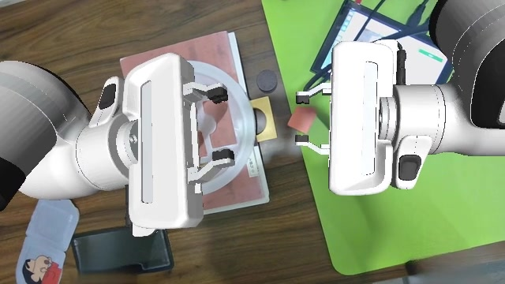
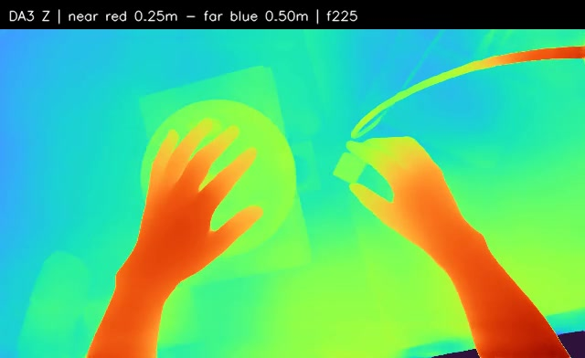
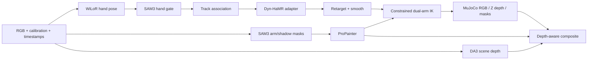

# Ego2Robot Open Reproduction

[](https://github.com/aownown/ego2robot-repro/actions/workflows/ci.yml)
[](LICENSE)
[](#requirements)

An open, inspectable reproduction of the six camera-relative stages in
[**Ego2Robot: Scalable Robot Data Synthesis from Egocentric Human Data**](https://arxiv.org/abs/2608.02580).
The project converts a first-person human manipulation clip into a synchronized
robot RGB/depth/mask stream and gripper trajectory, while preserving explicit
quality flags and refusing to turn “completed” into “validated.”

> This is an independent engineering reproduction, not the authors' official
> implementation. It covers one-input Path B through arm visual synthesis and
> depth compositing. It does not reproduce the paper's dataset scale, downstream
> VLA training, benchmark results, or real-robot experiments.

<table>
  <tr>
    <td align="center"><br><sub>Final robot composite, frame 225 (7.5 s)</sub></td>
    <td align="center"><br><sub>DA3 scene depth, same frame; RGB-estimated, not sensor truth</sub></td>
  </tr>
</table>



## What works

| Stage | Implementation | Verified output |
|---|---|---|
| 1. 3D hand pose | WiLoR, SAM3 hand-mask gating, track association, camera-relative Dyn-HaMR adapter | Two MANO-parameterized hand tracks |
| 2. Action alignment | Hand-to-parallel-gripper mapping, velocity filtering, Savitzky–Golay and SLERP | TCP, rotation, width, validity flags |
| 3. Visual masking | SAM3 arm segmentation, optional shadow proposal and merge | Aligned binary masks |
| 4. Human removal | ProPainter with OOM-aware full-clip preset | Inpainted RGB |
| 5. Robot synthesis | Dual-Panda base search, constrained IK, collision/visibility checks, MuJoCo rendering | Robot RGB, Z depth, masks |
| 6. Depth composite | DA3 metric-large from RGB, robot/scene occlusion comparison | Composite RGB and depth |

The acceptance run processed **450 frames at 1280x720 and 30 fps**. All six
stages completed, while the release intentionally keeps:

```text
visual_quality_accepted      = false
physical_scale_validated     = false
world_trajectory_recovered   = false
```

Those flags are not a cosmetic disclaimer. In the sampled review, the ProPainter
background still contains visible hand/shadow ghosting and local blur. DA3 depth
is estimated from RGB, not measured sensor depth. The original sensor depth is
not aligned or unit-verified, and the hand trajectory is camera-relative.

## Quick start

### 1. Requirements

- Linux, NVIDIA GPU, CUDA-capable driver
- Conda/Miniconda, Git, FFmpeg/FFprobe, build tools
- EGL-capable graphics libraries for offscreen MuJoCo rendering
- About 50 GB free space for seven isolated environments, upstream source,
  weights, and one full-clip run

The verified reference environment was Ubuntu 20.04 with eight A100 40GB GPUs.
The implemented OOM-safe ProPainter setting targets a 640x360 background pass.
Tests on other GPUs are welcome; do not infer an equivalent memory budget from
model names alone.

### 2. Clone and configure

```bash
git clone https://github.com/aownown/ego2robot-repro.git
cd ego2robot-repro

export CONDA_BIN=/path/to/conda
export PROJECT="$PWD"
export WORKFLOW="$PROJECT/workflow"
export CLIP="$PROJECT/test_data"
export TEST_ROOT="$PROJECT/test_data/_test1019"
export CUDA_VISIBLE_DEVICES=0
```

Review [`DATA.md`](DATA.md) and obtain the licensed MANO model, SAM 3 access,
and a compatible input clip. The repository does not redistribute the source
video, videos of identifiable people, MANO, SAM weights, or other checkpoints.

### 3. Fetch pinned source and weights

```bash
bash workflow/step_one_WiLoR_and_DynHaMR/prepare.sh sources
bash workflow/prepare_all.sh sources
bash workflow/step_one_WiLoR_and_DynHaMR/prepare.sh wilor-env
bash workflow/step_one_WiLoR_and_DynHaMR/prepare.sh wilor-weights
bash workflow/step_one_WiLoR_and_DynHaMR/prepare.sh mano /path/to/MANO_RIGHT.pkl
bash workflow/step_one_WiLoR_and_DynHaMR/prepare.sh dynhamr-base
bash workflow/step_one_WiLoR_and_DynHaMR/prepare.sh dynhamr-assets
bash workflow/step_one_WiLoR_and_DynHaMR/prepare.sh bmc
bash workflow/prepare_all.sh env
bash workflow/prepare_all.sh weights
```

Download behavior and third-party boundaries are in
[`THIRD_PARTY.md`](THIRD_PARTY.md) and
[`workflow/sources.lock.json`](workflow/sources.lock.json). Some resources
require a user login or access agreement and can never be fetched blindly.

### 4. Validate installed runtimes

```bash
bash workflow/step_one_WiLoR_and_DynHaMR/prepare.sh wilor-check
bash workflow/prepare_all.sh check
bash workflow/prepare_all.sh model-check
python3 tools/repo_check.py
```

### 5. Run the complete pipeline

The executor accepts paths rather than hardcoded machine folders:

```bash
python3 test_data/_test1019/scripts/run_pipeline.py --help
bash test_data/_test1019/scripts/04_run_full_pipeline.sh
```

The historical `_test1019` directory name is retained as the identifier of the
acceptance run. It records the exact evidence and is not a request to rebuild
the cloud instance. For new data, create a new run root and pass its paths rather
than overwriting accepted results.

## Results and media

The detailed evidence report is
[`test_data/_test1019/reports/TEST_REPORT.md`](test_data/_test1019/reports/TEST_REPORT.md).
The machine-readable result summary is
[`status.json`](test_data/_test1019/reports/status.json), and the larger
exhaustive record is
[`results.json`](test_data/_test1019/reports/results.json).

Key measurements from the tested clip:

- 450 input frames, 30 fps, 15 seconds
- 918 raw WiLoR detections; 18 same-handed duplicate frames; 900 retained
- 450/450 robot geometry-valid frames
- 271/450 strict-valid frames; 177 right-width clipping frames
- 0 joint jumps, self collisions, cross-arm collisions, or camera-keepout collisions
- 3600 input hashes and 27 videos independently checked

These are numerical and geometric checks. They do not certify visual fidelity,
physical hand scale, real-scene collision, or real-robot execution.

### Demonstration media

Two representative frames above document the final composite and the separate
RGB-depth estimate. The source clip, complete frame sequences, raw sensor depth,
and other large artifacts are intentionally excluded. The aggregate metrics,
visual-review findings, hashes, and limitations remain under
`test_data/_test1019/reports/`.

## Architecture and data contracts

```text
RGB frames + calibration + timestamps
  ├─ WiLoR → SAM3 hand gate → tracking → Dyn-HaMR adapter → hand tracks
  │                                              └─ retarget + smoothing
  ├─ SAM3 arm/shadow masks → ProPainter → inpainted RGB
  │                                         └─ base search + constrained IK
  │                                              → MuJoCo robot RGB/Z/masks
  ├─ original RGB → DA3 metric-large → scene depth
  └──────────────────────────────→ depth-aware composite
```

Start with [`workflow/README.md`](workflow/README.md) for commands and
[`workflow/DATA_CONTRACT.md`](workflow/DATA_CONTRACT.md) for the coordinate,
unit, timestamp, and mask contracts. Every boundary carries provenance and
quality flags; a finite tensor is not a trustworthy observation.

## Engineering contribution

This repository's original work includes:

- a six-stage orchestration layer with resumable stages and independent checks;
- a documented WiLoR-to-Dyn-HaMR camera-relative adapter and temporal loss;
- deterministic dual-hand association and mask-gated candidate handling;
- explicit short-gap, boundary-gap, interpolation, and validity semantics;
- a small public-contribution boundary for upstream fixes, including the
  ProPainter output-size patch needed to preserve 640x360 geometry;
- hand-to-gripper target conversion and temporal smoothing;
- dual-arm base-candidate search and constrained IK with collision and camera
  visibility checks;
- depth-aware robot compositing with an arm-only human protection mask;
- portable setup scripts, pinned dependencies, provenance capture, and
  CPU-optimized CI checks.

Upstream model algorithms remain the work of their authors. See
[`THIRD_PARTY.md`](THIRD_PARTY.md).

## Contribute a citation

If you use, adapt, or extend this project, add it to
[`docs/USERS.md`](docs/USERS.md) in a pull request or open an issue with the
repository/project link and the stage you used. This helps downstream readers
find tested variants and gives maintainers concrete evidence of real use.

## Project status

Version `0.1.0` is a research reproduction. The most valuable next contributions
are aligned sensor depth, world-space camera recovery, improved shadow removal,
a second robot morphology, and validation on additional clips. See
[`ROADMAP.md`](ROADMAP.md) and [`workflow/note.md`](workflow/note.md).

## Citation and contact

If this reproduction helps your research, cite the Ego2Robot paper and this
repository. The machine-readable entry is in [`CITATION.cff`](CITATION.cff).

Maintainer: [Liu Yanming (@aownown)](https://github.com/aownown)
